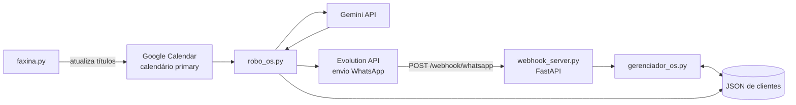

# Visão geral da arquitetura

Voltar para [[01 - Arquitetura/Indice|Índice de Arquitetura]] · Ver também [[01 - Arquitetura/Tecnologias-e-configuracao|Tecnologias e configuração]].

## Propósito confirmado

O programa automatiza a preparação e o envio de O.S. a partir de eventos do calendário principal. O processo principal fica em [`robo_os.py`](../../../robo_os.py#L199): autentica no Google Calendar, lista eventos, valida se o título ou a descrição informa duração, usa Gemini para formatar a O.S., envia o texto pela Evolution API e atualiza o título do evento como marcador. No mesmo processo, uma thread inicia o servidor FastAPI.

O webhook [`webhook_server.py`](../../../webhook_server.py#L55) recebe comandos de WhatsApp e delega operações de cadastro ao [`gerenciador_os.py`](../../../gerenciador_os.py#L29). Os dois consumidores leem e escrevem um arquivo JSON local de clientes. O utilitário [`faxina.py`](../../../faxina.py#L5) é independente do loop principal.

## Componentes e relações

O envio da resposta aos comandos também é feito pelo webhook para a Evolution API. As relações desenhadas correspondem às chamadas e leituras observadas no código; a configuração/infraestrutura de implantação da Evolution API não está versionada.

## Componentes principais

- **Processador** — `robo_os.py`: loop contínuo, consulta eventos, valida conteúdo, chama Gemini, envia mensagem e marca eventos.
- **Interface de entrada** — `webhook_server.py`: endpoint HTTP `POST /webhook/whatsapp`; agenda as respostas como tarefas de background do FastAPI.
- **Persistência do cadastro** — `gerenciador_os.py`: manipula as seções `CLIENTES_CONTRATO` e `CLIENTES_AVULSOS` no JSON.
- **Utilitário de calendário** — `faxina.py`: marca eventos de uma faixa de datas fixa com `[ENVIADO]`.

Detalhes por arquivo: [[02 - Modulos/Indice|índice de módulos]].
