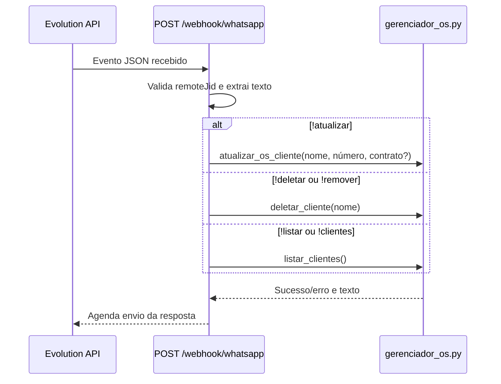

# Comandos WhatsApp

Voltar para [[03 - Fluxos/Indice|Índice de Fluxos]] · Módulos em [[02 - Modulos/webhook-server|webhook_server.py]] e [[02 - Modulos/gerenciador-os|gerenciador_os.py]].

## Entrada e roteamento

## Sintaxe identificada

| Comando | Argumentos observados | Resultado |
|---|---|---|
| `!listar` ou `!clientes` | Nenhum | Lista clientes e números de O.S. por categoria. |
| `!atualizar` | `Nome, Número_OS, sim/nao` | Atualiza/adiciona cliente como contrato ou avulso; `sim`, `s`, `true`, `1` são tratados como contrato. Outros valores tornam-se avulso. |
| `!deletar` ou `!remover` | Nome | Remove o cliente das categorias em que for encontrado. |

O separador dos argumentos de `!atualizar` é vírgula; nomes que contenham vírgula não são suportados por essa divisão simples. O handler verifica que existam ao menos três partes, mas usa apenas as três primeiras.

Para todos os comandos, o remetente deve corresponder exatamente ao `JID_WHATSAPP` configurado. A forma exata do JSON recebido e as opções de payload aceitas são descritas em [[05 - Interfaces e Integracoes/Contratos-externos|interfaces externas]].
